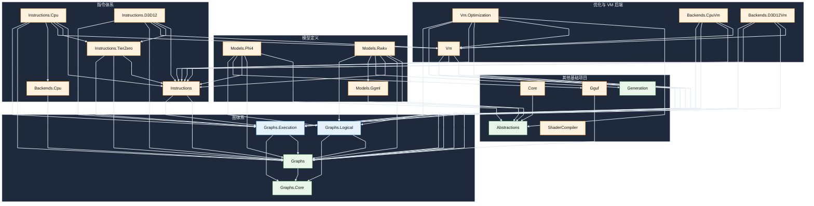
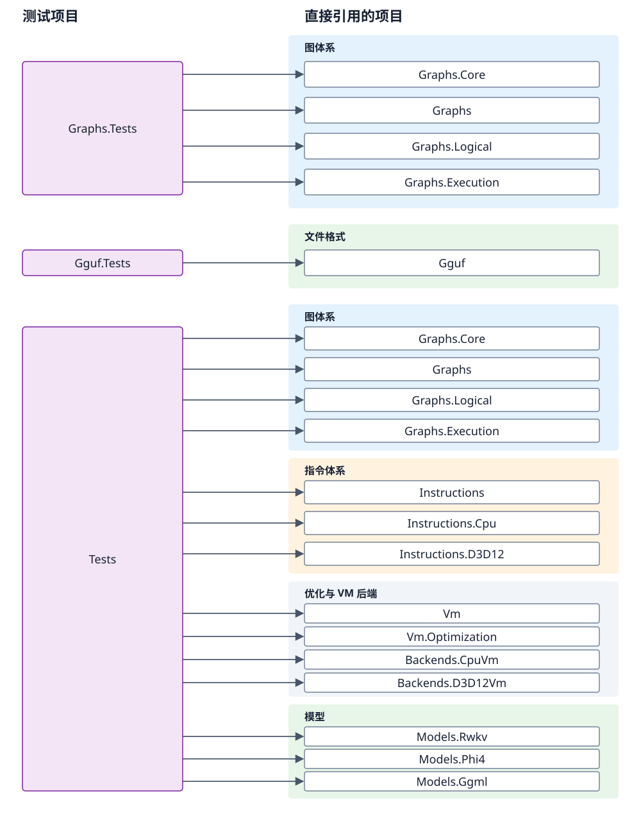

# 解决方案项目依赖图

以当前 `SharpInference.slnx` 中各项目的 `ProjectReference` 为依据。
共 24 个项目、72 条直接项目引用，无循环引用。

- 箭头 `A → B` 表示 A 引用 B。
- 节点省略统一的 `SharpInference.` 前缀。
- 保留所有直接引用，不删除与传递依赖重复的边。
- 不包括 NuGet 包、运行时调用，以及未加入解决方案的目录。

## 一、生产项目

21 个项目、53 条直接引用。保留项目分类，使用直线/折线连线。

`ShaderCompiler` 当前没有声明项目引用，也没有被其他解决方案项目通过
`ProjectReference` 引用，因此在图中没有连线。

## 二、测试项目

3 个测试项目、19 条直接引用。以下是完整测试项目图，不是局部示例。
采用固定布局，每条引用都是单根水平直线箭头，没有曲线和折点；
目标按图体系、指令体系、优化与 VM 后端、模型与文件格式分类。
不同测试区域内出现的同名目标表示同一个项目。

[打开矢量原图](images/project-test-dependencies.svg)

## 三、依赖边界

- Graphs 只引用 Graphs.Core。
- Graphs.Logical、Graphs.Execution 均只引用 Graphs、Graphs.Core，彼此不引用。
- Instructions 引用 Graphs、Graphs.Execution，不引用 Graphs.Logical。
- Models.Phi4、Models.Rwkv 直接引用 Graphs.Logical；
  同时它们引用 Instructions，因此会传递依赖 Graphs.Execution。
- Graphs.Tests 只引用图体系，不引用 Instructions、优化器、模型或 VM。
