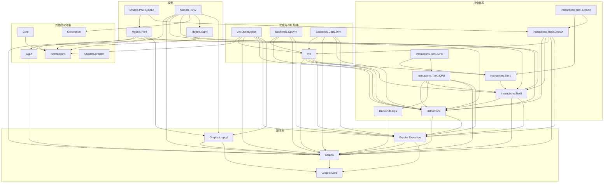
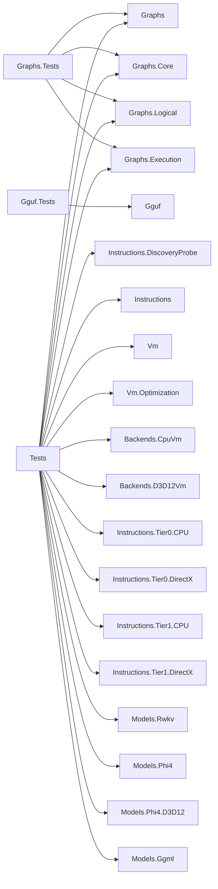
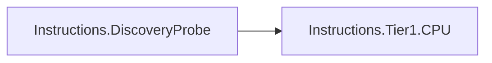

# 解决方案项目依赖图

以当前 `SharpInference.slnx` 中各项目的 `ProjectReference` 为依据。
共 29 个项目、87 条直接项目引用，无循环引用。

- 箭头 `A → B` 表示 A 引用 B，省略统一的 `SharpInference.` 前缀。
- 保留全部直接引用，包含构建用的 `ReferenceOutputAssembly="false"` 引用。
- 不包含 NuGet、运行时调用或未加入解决方案的目录。
- 指令分层及算子完整归属表见 [指令架构](instruction-architecture.md)。

## 一、生产项目

25 个项目、63 条直接引用。

`ShaderCompiler` 没有项目引用，也没有被其他解决方案项目直接引用。

## 二、测试项目

3 个测试项目、23 条直接引用。`Tests → Instructions.DiscoveryProbe`
仅用于构建独立进程探针，不把探针输出程序集作为测试代码引用。

## 三、工具项目

1 个项目、1 条直接引用：

探针不触碰实现类型，验证未加载的传递依赖（包括 Tier0.CPU）能从运行依赖清单发现。

## 四、依赖边界

- Graphs 只引用 Graphs.Core。
- Graphs.Logical、Graphs.Execution 均只引用 Graphs、Graphs.Core，彼此不引用。
- Instructions 引用 Graphs、Graphs.Execution，不引用任何 Tier 或实现包。
- Tier0/Tier1 契约与 CPU/DirectX 实现分包；T1 实现复用相应 T0 实现。
- VM 为既有矩阵启动校验引用 T0/T1 契约，但不引用具体指令实现包。
- Models.Phi4、Models.Rwkv 直接引用 Graphs.Logical、Tier0；
  因 Instructions 的现有引用，会传递依赖 Graphs.Execution。
- Phi4 专用 D3D12 实现单列项目，不放入通用 T1.DirectX。
- Graphs.Tests 只引用图体系，不引用 Instructions、优化器、模型或 VM。
